<div align="center">

# Explainable Artificial Intelligence in Medical Systems

### From Black Box Models to Reliable Clinical Decision Support

**IEEE CARS 2026 Workshop**<br>
Organised by the Center for Cyber Security Research (C2SR), University of North Dakota<br>
Grand Forks, ND, USA · 28 October 2026 · 2 hours, online session

<a href="https://utkukose.github.io/xai-cars2026-NB-workshop/"></a>
&nbsp;&nbsp;
<a href="https://colab.research.google.com/github/utkukose/xai-cars2026-NB-workshop/blob/main/notebooks/NB1_Black_Box_Problem.ipynb"></a>

[](https://ieee-cars.org/program/workshops/workshop-explainable-artificial-intelligence-in-m)
[](https://engineering.und.edu/research/cyber-security/)
[](https://engineering.und.edu/research/cyber-security/cars.html)
[](https://www.python.org/)
[](https://github.com/utkukose/xai-cars2026-NB-workshop/actions/workflows/notebooks.yml)
[](https://creativecommons.org/licenses/by-nc-sa/4.0/)

**Prof. Dr. Utku Köse**<br>
Department of Computer Engineering, Süleyman Demirel University, Isparta, Türkiye<br>
Director, Artificial Intelligence Application and Research Center (YAZEM), Süleyman Demirel University<br>
University of North Dakota, Grand Forks, USA<br>
Universidad Panamericana, Mexico City, Mexico<br>
Vel Tech University, Chennai, India<br>
IEEE Senior Member · ACM Professional Member

[](https://orcid.org/0000-0002-9652-6415)
[](https://www.utkukose.com)
[](https://github.com/utkukose)

</div>

---

<p align="center">
<a href="https://utkukose.github.io/xai-cars2026-NB-workshop/">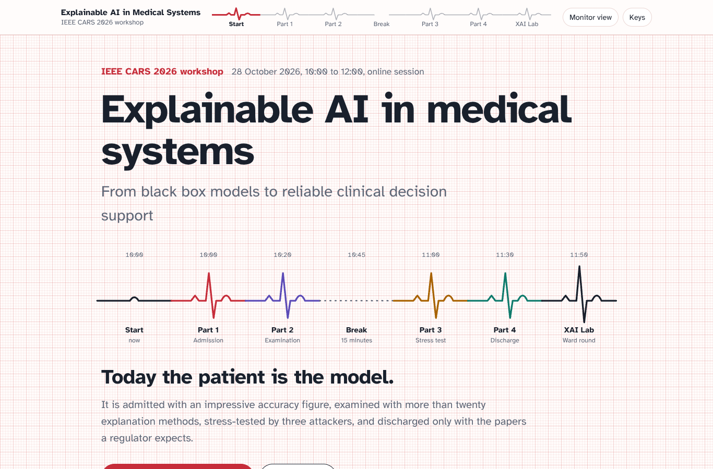</a><br>
<sub>The start page of the workshop site. The morning is one rhythm strip: four parts, a break and the XAI Lab, each a page of its own.</sub>
</p>

## About

This repository contains the complete material of the two-hour workshop *Explainable Artificial Intelligence in Medical Systems: From Black Box Models to Reliable Clinical Decision Support*. The workshop takes place on 28 October 2026, the third day of the IEEE Cyber Awareness and Research Symposium (IEEE CARS 2026), which is organised by the [Center for Cyber Security Research (C2SR)](https://engineering.und.edu/research/cyber-security/) of the University of North Dakota in Grand Forks, North Dakota, USA. The session itself is delivered online.

The workshop treats a clinical model as a patient. The model is admitted with an impressive accuracy figure, examined with more than twenty explanation methods, stress-tested by three attackers, and discharged only with the papers a regulator expects. The session runs entirely from this repository: an interactive page opens each part, a Colab notebook carries the full analysis, and the XAI Lab brings every tool together at the end. Every dataset is real, openly accessible and downloaded by the notebooks themselves; no simulated patient data are used anywhere.

## How the session works

Each part follows the same three steps. **Explore:** a short page on the [workshop site](https://utkukose.github.io/xai-cars2026-NB-workshop/) opens with a cold open and continues with a few interactive stations, each built around one prediction and one reveal on real data. **Code:** the matching Colab notebook reproduces every number of the page and carries the full analysis, so participants can run it, change it and break it. **Bring it together:** the XAI Lab puts every tool of the morning on one bench and closes the session with a debrief that summarises what each participant did in their browser.

## Programme

| Time | Part | Interactive page | Notebooks |
|---|---|---|---|
| 10:00 | Opening | [Start page](https://utkukose.github.io/xai-cars2026-NB-workshop/) | |
| 10:00–10:20 | **Part 1 · Admission.** The black box problem | [part1.html](https://utkukose.github.io/xai-cars2026-NB-workshop/part1.html) | NB1 |
| 10:20–10:45 | **Part 2 · Examination.** The XAI toolkit | [part2.html](https://utkukose.github.io/xai-cars2026-NB-workshop/part2.html) | NB2, NB3 |
| 10:45–11:00 | Break | [break.html](https://utkukose.github.io/xai-cars2026-NB-workshop/break.html) | |
| 11:00–11:30 | **Part 3 · Stress test.** Attacks and XAI-based analysis | [part3.html](https://utkukose.github.io/xai-cars2026-NB-workshop/part3.html) | NB4, NB5, NB6 |
| 11:30–11:50 | **Part 4 · Discharge.** Governance and the dashboard | [part4.html](https://utkukose.github.io/xai-cars2026-NB-workshop/part4.html) | NB7, `dashboard/` |
| 11:50–12:00 | **Ward round.** XAI Lab, debrief, questions and discussion | [lab.html](https://utkukose.github.io/xai-cars2026-NB-workshop/lab.html) | |

The run sheet with timings, questions for the conference platform and a fallback plan is in [WORKSHOP_GUIDE.md](WORKSHOP_GUIDE.md).

## The interactive pages

| Page | What participants do |
|---|---|
| **Part 1 · The black box problem** | Decide whether to deploy a network with 97 percent accuracy, move its threshold and count the missed cancers, hunt for the cancers among biopsies the network calls benign with 99.8 percent confidence, test whether 0.9 means 90 percent, watch a model that learned the hospital instead of the disease, and place the EU AI Act, the FDA and the GDPR on one timeline. |
| **Part 2 · The XAI toolkit** | Open the black box into a periodic table of methods, race glass-box models against the black box, read the tree and the GAM curves, compute exact Shapley values for a patient, ask LIME twice, find the smallest change that flips a decision, measure faithfulness with a deletion test, and randomise the model to see which explanations notice. |
| **Break** | A countdown, a looping preview of Part 3 and one question to answer before 11:00. |
| **Part 3 · Attacks and XAI-based analysis** | Meet three attackers, silence a correct hypoglycaemia alert by hand or with a decision-based attack, find out which explanation gives the manipulation away, watch a Page-Hinkley monitor catch a campaign, replay an attacked ICU stay hour by hour, and choose how much timing noise it takes to hide atrial fibrillation. |
| **Part 4 · Governance and the dashboard** | Watch a discharge checklist fill in from the evidence of the morning, sort eight systems into the tiers of the AI Act, audit the model for women and men with live bootstrap intervals, write and download a model card, and override a recommendation in a miniature clinician dashboard that keeps an audit log. |
| **XAI Lab** | Every tool on one bench, a ward round of six tasks, an audit tab, and the debrief: a discharge summary for the model built from what the participant did during the session. |

<table>
<tr>
<td width="50%"><a href="https://utkukose.github.io/xai-cars2026-NB-workshop/part1.html">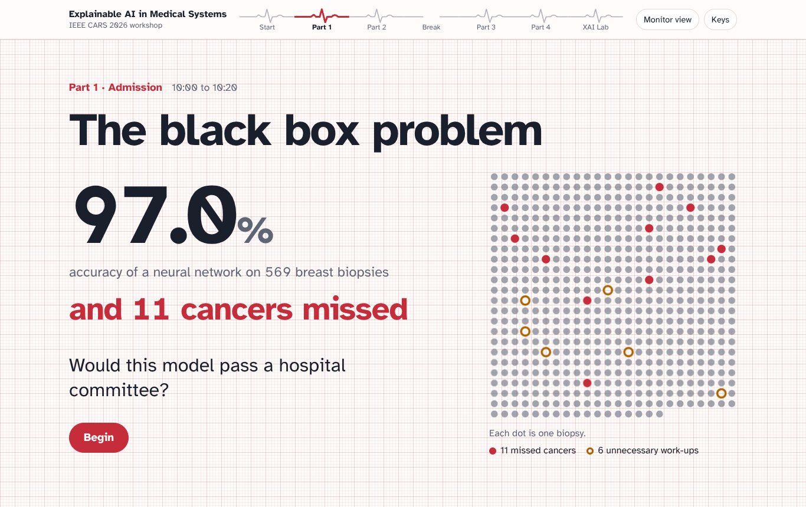</a></td>
<td width="50%"><a href="https://utkukose.github.io/xai-cars2026-NB-workshop/part2.html">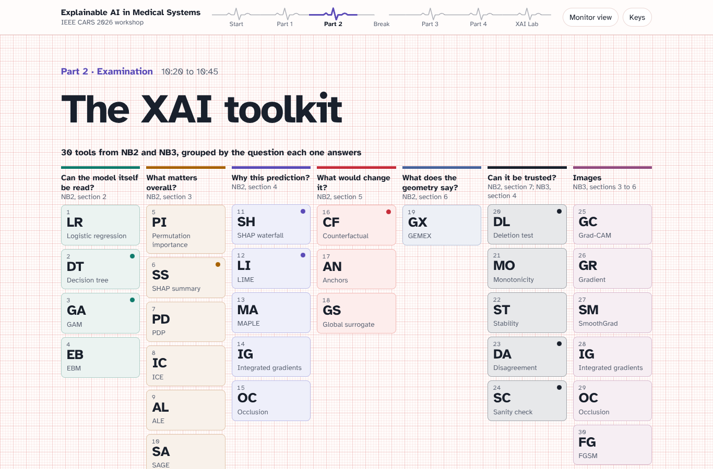</a></td>
</tr>
<tr>
<td><sub>Part 1. The network is 97 percent accurate; the cold open counts the cancers it misses.</sub></td>
<td><sub>Part 2. The black box opens into the toolkit, grouped by the question each method answers.</sub></td>
</tr>
<tr>
<td width="50%"><a href="https://utkukose.github.io/xai-cars2026-NB-workshop/part3.html">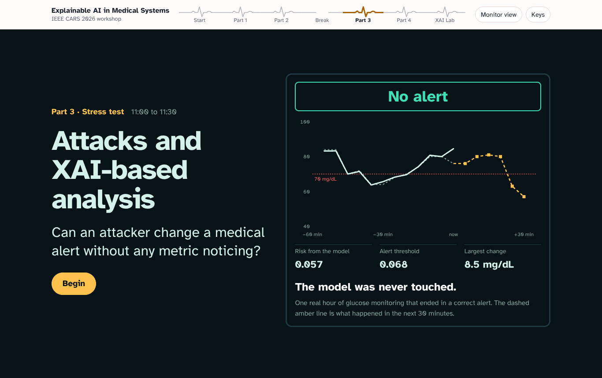</a></td>
<td width="50%"><a href="https://utkukose.github.io/xai-cars2026-NB-workshop/part4.html">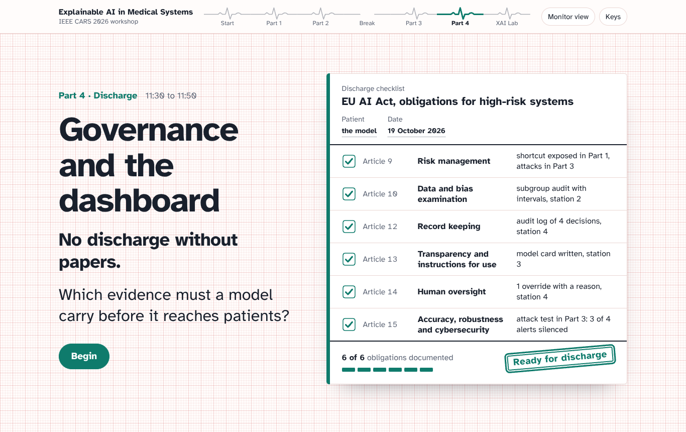</a></td>
</tr>
<tr>
<td><sub>Part 3. On a bedside monitor a correct alarm falls silent, and the model was never touched.</sub></td>
<td><sub>Part 4. The discharge papers fill in as the evidence of the morning comes together.</sub></td>
</tr>
<tr>
<td width="50%"><a href="https://utkukose.github.io/xai-cars2026-NB-workshop/break.html">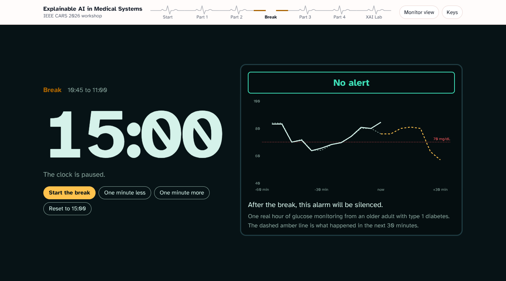</a></td>
<td width="50%"><a href="https://utkukose.github.io/xai-cars2026-NB-workshop/lab.html#debrief">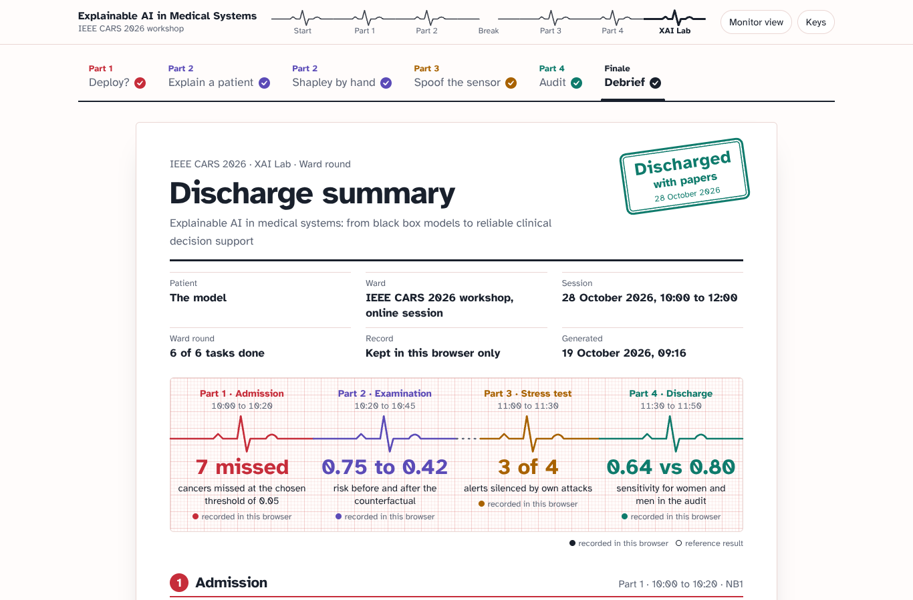</a></td>
</tr>
<tr>
<td><sub>The break screen with its countdown and a preview of the attack.</sub></td>
<td><sub>The XAI Lab closes the session with a discharge summary of what each participant did.</sub></td>
</tr>
</table>

All pages run their models in the browser and send nothing anywhere. On every page the arrow keys move between stations, `[` and `]` move between parts, `T` switches between the paper view and the dark monitor view, and `F` toggles full screen. The models behind the pages are exported from the notebooks' own code by `tools/build_site_data.py`, and the JavaScript implementation reproduces the scikit-learn predictions and the exact Shapley values of Python to within floating point rounding.

To publish the site, enable GitHub Pages in the repository settings with the source *Deploy from a branch*, branch `main`, folder `/docs`.

## Notebooks

Each button opens the notebook in Google Colab. The first cell installs any missing package, the data are downloaded into a local `workshop_data/` folder, and every notebook runs on a free Colab CPU in one to eight minutes. NB3 is faster with a GPU runtime. Each notebook begins with a link to its interactive page and ends with the next step of the session.

| Notebook | Question | Data | Methods |
|---|---|---|---|
| **NB1 · The Black Box Problem**<br><br><a href="https://colab.research.google.com/github/utkukose/xai-cars2026-NB-workshop/blob/main/notebooks/NB1_Black_Box_Problem.ipynb"></a> | What does a 97 percent accuracy figure hide? | Wisconsin Diagnostic Breast Cancer | out-of-fold evaluation, threshold trade-offs, confident errors, calibration, shortcut learning |
| **NB2 · XAI Toolkit I: Tabular**<br><br><a href="https://colab.research.google.com/github/utkukose/xai-cars2026-NB-workshop/blob/main/notebooks/NB2_XAI_Toolkit_Tabular.ipynb"></a> | Which method answers which question, and can its answer be trusted? | UCI Cleveland heart disease | logistic regression, tree, spline GAM, EBM, permutation importance, SHAP, PDP and ICE, ALE, SAGE, LIME, MAPLE, integrated gradients, counterfactuals, Anchors, global surrogate, GEMEX, faithfulness, monotonicity, stability, disagreement |
| **NB3 · XAI Toolkit II: Imaging**<br><br><a href="https://colab.research.google.com/github/utkukose/xai-cars2026-NB-workshop/blob/main/notebooks/NB3_XAI_Toolkit_Imaging.ipynb"></a> | Do heat maps explain the model or the image? | PneumoniaMNIST (MedMNIST v2) | CNN, Grad-CAM, gradients, SmoothGrad, integrated gradients, occlusion, cascading randomisation, deletion test, FGSM |
| **NB4 · Attack 1: CGM hypoglycaemia alerts**<br><br><a href="https://colab.research.google.com/github/utkukose/xai-cars2026-NB-workshop/blob/main/notebooks/NB4_Attack_CGM_Hypoglycemia.ipynb"></a> | Can a correct low-glucose alert be silenced within sensor error? | Weinstock et al. type 1 diabetes CGM data (via GlucoBench) | decision-based attack in the spirit of HopSkipJump, SHAP anomaly score, counterfactual margin, GEMEX, Page-Hinkley |
| **NB5 · Attack 2: ICU sepsis alerts**<br><br><a href="https://colab.research.google.com/github/utkukose/xai-cars2026-NB-workshop/blob/main/notebooks/NB5_Attack_ICU_Sepsis.ipynb"></a> | Can a sepsis alert be delayed while every validation metric stays unchanged? | PhysioNet/CinC Challenge 2019 | streaming score-based attack in the spirit of ZOO, the same XAI-based signals |
| **NB6 · Attack 3: wearable AF detection**<br><br><a href="https://colab.research.google.com/github/utkukose/xai-cars2026-NB-workshop/blob/main/notebooks/NB6_Attack_Wearable_AF.ipynb"></a> | How much timing noise does it take to hide atrial fibrillation? | MIT-BIH Atrial Fibrillation Database | decision-based attack with a budget ladder, Poincaré plots, the same XAI-based signals |
| **NB7 · From Explanation to Governance**<br><br><a href="https://colab.research.google.com/github/utkukose/xai-cars2026-NB-workshop/blob/main/notebooks/NB7_Governance_and_Dashboard.ipynb"></a> | How do explanations become evidence? | UCI Cleveland heart disease | EU AI Act risk map, subgroup audit with bootstrap intervals, counterfactual fairness probe, model card, mini dashboard |

### Inside the notebooks

<table>
<tr>
<td width="50%">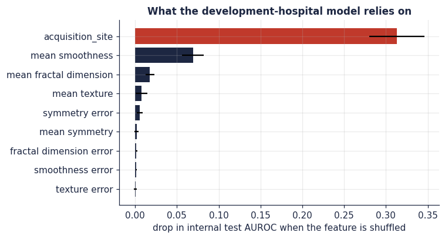</td>
<td width="50%">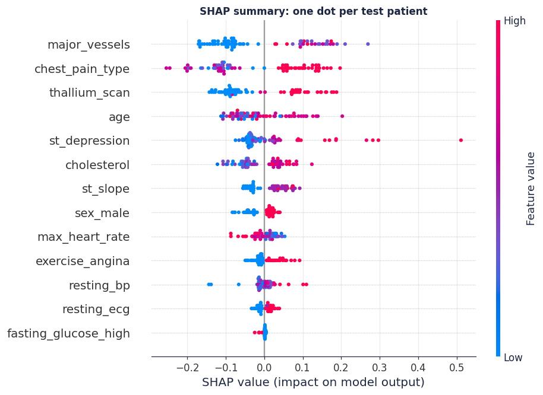</td>
</tr>
<tr>
<td><sub>NB1: a model that learned the hospital instead of the disease.</sub></td>
<td><sub>NB2: SHAP summary of the gradient boosting model.</sub></td>
</tr>
<tr>
<td width="50%">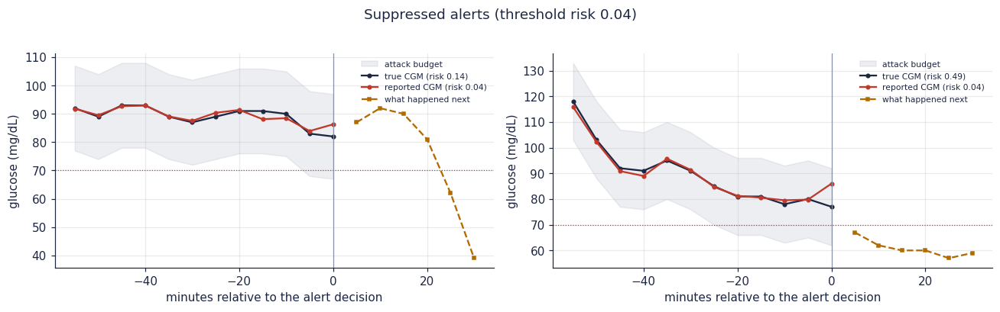</td>
<td width="50%">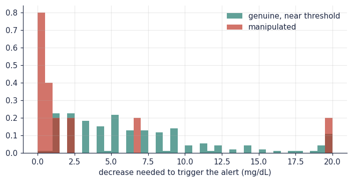</td>
</tr>
<tr>
<td><sub>NB4: readings nudged within 15 mg/dL silence correct alerts before real lows.</sub></td>
<td><sub>NB4: manipulated windows sit much closer to the alert boundary.</sub></td>
</tr>
<tr>
<td colspan="2">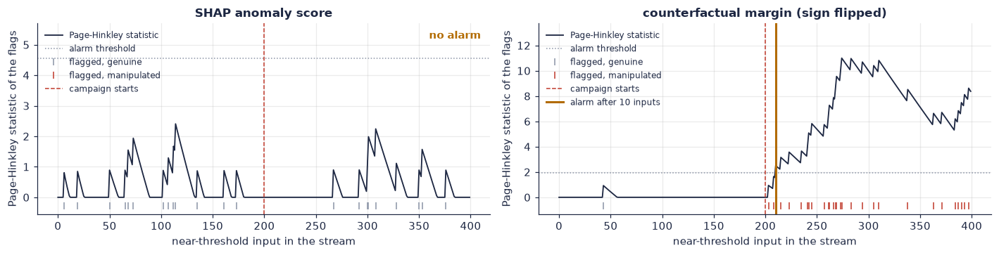</td>
</tr>
<tr>
<td colspan="2"><sub>NB4: the same Page-Hinkley test watches the flags of two signals while one window in five is manipulated. Flags from the counterfactual margin raise the alarm ten inputs into the campaign; flags from the SHAP anomaly score never do.</sub></td>
</tr>
<tr>
<td colspan="2">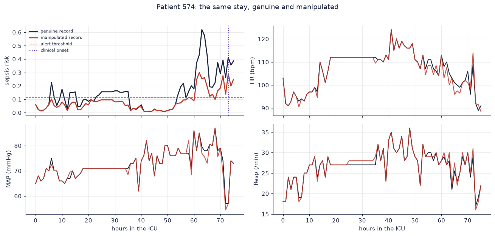</td>
</tr>
<tr>
<td colspan="2"><sub>NB5: one real ICU stay, genuine and manipulated hour by hour. The genuine record raises the sepsis alert at hour 6; the manipulated record stays below the threshold until hour 61, twelve hours before clinical onset.</sub></td>
</tr>
<tr>
<td width="50%">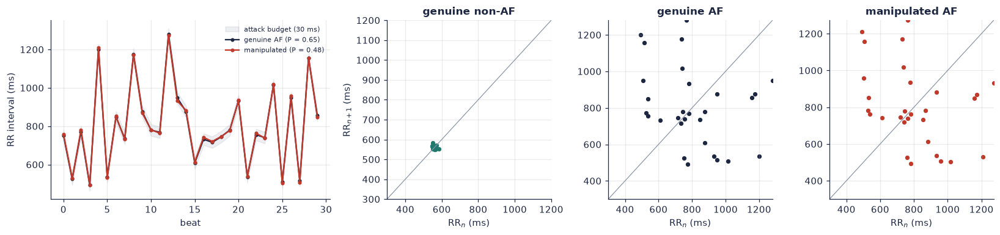</td>
<td width="50%">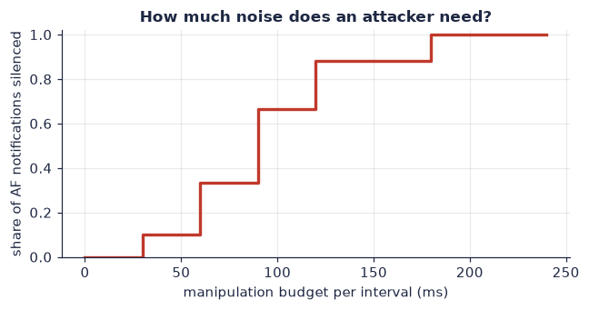</td>
</tr>
<tr>
<td><sub>NB6: a real AF window before and after the attack, as a tachogram and Poincaré plots.</sub></td>
<td><sub>NB6: how much timing noise per beat it takes to silence correct AF notifications.</sub></td>
</tr>
<tr>
<td width="50%">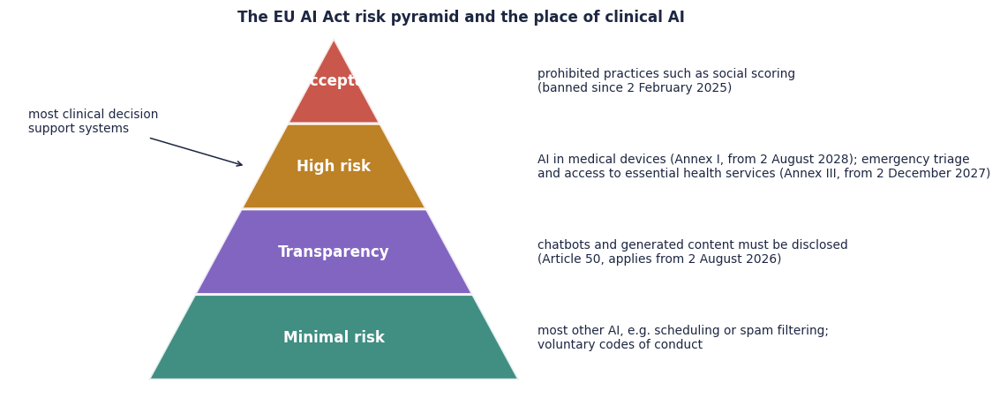</td>
<td width="50%">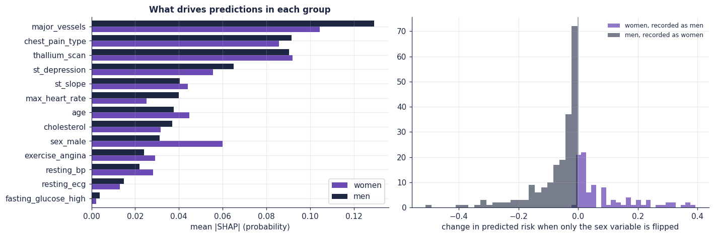</td>
</tr>
<tr>
<td><sub>NB7: the place of clinical AI under the EU AI Act.</sub></td>
<td><sub>NB7: what drives predictions for women and men, and what flipping only the sex variable does.</sub></td>
</tr>
</table>

## XAI Lab

The [XAI Lab](https://utkukose.github.io/xai-cars2026-NB-workshop/lab.html) is the finale of the session. It keeps every tool of the morning on one bench: *Deploy?* (Part 1), *Explain a patient* and *Shapley by hand* (Part 2), *Spoof the sensor* (Part 3) and an *Audit* tab (Part 4), with a ward round of six tasks across them. Its *Debrief* tab closes the workshop with a discharge summary for the model, built from the answers and results each participant left on the pages and in the lab, together with the notebooks opened from the site. The summary stays in the participant's browser and can be printed or saved as a PDF. Each tab can be linked directly, for example [lab.html#spoof](https://utkukose.github.io/xai-cars2026-NB-workshop/lab.html#spoof).

<p align="center">
<a href="https://utkukose.github.io/xai-cars2026-NB-workshop/lab.html#spoof">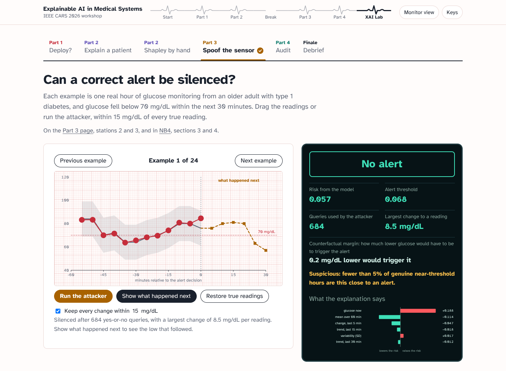</a><br>
<sub>The <i>Spoof the sensor</i> tab: the attacker silences a correct alert with changes of at most 8.5 mg/dL, and the counterfactual margin shows how close the silence is to the alert.</sub>
</p>

## Dashboard

The Streamlit dashboard shows a patient's predicted risk with its SHAP explanation, a what-if panel with a counterfactual search, the population view, a subgroup audit with bootstrap intervals and a downloadable model card.

```bash
pip install -r requirements.txt
streamlit run dashboard/app.py
```

## Data

| Dataset | Used in | Source | Licence |
|---|---|---|---|
| Wisconsin Diagnostic Breast Cancer | NB1, Part 1, Lab | bundled with scikit-learn (UCI) | CC BY 4.0 |
| UCI Cleveland heart disease | NB2, NB7, Parts 2 and 4, Lab, dashboard | UCI Machine Learning Repository | CC BY 4.0 |
| PneumoniaMNIST, 64 × 64 (MedMNIST v2) | NB3 | Zenodo record 10519652 | CC BY 4.0 |
| Weinstock et al. (2016) CGM data of older adults with type 1 diabetes | NB4, Part 3, Lab | GlucoBench repository, pinned commit | CC BY-SA 4.0, as listed by GlucoBench |
| PhysioNet/Computing in Cardiology Challenge 2019, training set A | NB5, Part 3 | PhysioNet open data | CC BY 4.0 |
| MIT-BIH Atrial Fibrillation Database (annotations only) | NB6, Part 3 | PhysioNet open data | Open Data Commons Attribution 1.0 |

The notebooks download the data at run time and verify checksums where a published value exists. The only data excerpts stored in this repository are in `docs/assets/site-data.js`: example CGM traces (CC BY-SA 4.0), hourly vital signs and risk trajectories of a few ICU stays (CC BY 4.0) and RR-interval windows of the AF database (ODC Attribution 1.0), each under its own licence.

## Getting started

**Online.** Open the [workshop site](https://utkukose.github.io/xai-cars2026-NB-workshop/) and click one of the orange buttons for Colab. Nothing else is needed.

**Local installation.**

```bash
git clone https://github.com/utkukose/xai-cars2026-NB-workshop.git
cd xai-cars2026-NB-workshop
python -m venv .venv && source .venv/bin/activate
pip install torch --index-url https://download.pytorch.org/whl/cpu
pip install -r requirements.txt
jupyter lab notebooks/
```

The site needs no build step: `docs/index.html` opens directly from disk.

**Quick mode.** Setting the environment variable `XAI_WORKSHOP_QUICK=1` shrinks sample sizes and iteration counts so that every notebook finishes in about a minute. The automated check uses it:

```bash
python tools/run_notebooks.py --quick
```

**Rebuilding the page data.** `python tools/build_site_data.py` downloads the datasets from their original sources, recomputes every block of `docs/assets/site-data.js` with the notebooks' own code and seeds, and checks that the exported models reproduce the scikit-learn predictions.

**Checking the site.** `npm install jsdom && node tools/check_site.js` loads every page with its scripts and reports runtime errors; the automated workflow runs the same check.

**Renaming the repository.** If the repository is forked or renamed, `python tools/set_repo_name.py NEW_NAME --owner NEW_OWNER` updates every Colab button, the GitHub Pages address and the citation files.

## Repository structure

```
xai-cars2026-NB-workshop/
├── notebooks/                 seven workshop notebooks (NB1 to NB7)
├── docs/                      the workshop site for GitHub Pages
│   ├── index.html             start page
│   ├── part1.html … part4.html  interactive pages of the four parts
│   ├── break.html             break screen with countdown
│   ├── lab.html               XAI Lab, ward round and debrief
│   ├── assets/                shared styles and scripts, page scripts, generated data
│   └── images/                screenshots and figures used in this README
├── dashboard/app.py           Streamlit dashboard
├── tools/
│   ├── build_site_data.py     recomputes the page data from the original datasets
│   ├── check_site.js          loads every page and reports runtime errors
│   ├── run_notebooks.py       executes all notebooks
│   └── set_repo_name.py       updates links after a rename
├── .github/workflows/         automated checks of the notebooks and the site
├── WORKSHOP_GUIDE.md          run sheet, questions and fallback plan
├── REFERENCES.md              consolidated references
├── CITATION.cff
├── requirements.txt
└── LICENSE
```

## Design principles

The workshop uses real, openly accessible data throughout, so that every number shown in the session can be reproduced by any participant. The pages and the notebooks share data, splits, models and seeds, so a result met on a page reappears in the notebook. Claims about explanations as a defence are kept to what the evidence supports: the pages and notebooks report how well each explanation-based signal separates manipulated from genuine inputs, including the cases where a signal is weak and the cases where an attack fails. The notebooks are written for teaching, and every section can be read as a lecture note without running the code.

## Related material

The graduate course *Explainable AI in Healthcare* at Universidad Panamericana develops the same themes over 23 notebooks in six modules: [xai-healthcare-NB-lecture](https://github.com/utkukose/xai-healthcare-NB-lecture). GEMEX, the geometric explainer used in NB2 and in the attack notebooks, is available on [PyPI](https://pypi.org/project/gemex/). All references are collected in [REFERENCES.md](REFERENCES.md).

## Citation

```bibtex
@misc{kose2026xaicars,
  author       = {K{\"o}se, Utku},
  title        = {Explainable Artificial Intelligence in Medical Systems: From Black Box Models
                  to Reliable Clinical Decision Support},
  howpublished = {Workshop materials, IEEE Cyber Awareness and Research Symposium (IEEE CARS 2026),
                  Center for Cyber Security Research (C2SR), University of North Dakota},
  address      = {Grand Forks, ND, USA},
  year         = {2026},
  month        = oct,
  url          = {https://github.com/utkukose/xai-cars2026-NB-workshop}
}
```

## License

The notebooks, the workshop site, the XAI Lab, the dashboard and all text in this repository are released under the [Creative Commons Attribution-NonCommercial-ShareAlike 4.0 International License](https://creativecommons.org/licenses/by-nc-sa/4.0/). Third-party datasets keep their own licences, listed in the data table above, and the data excerpts in `docs/assets/site-data.js` keep the licence of the dataset they come from. Third-party software is used under its respective licence. See [LICENSE](LICENSE).

## Acknowledgements

The author thanks the Center for Cyber Security Research (C2SR) of the University of North Dakota for organising IEEE CARS 2026, in particular the General Chair and C2SR Director, Dr. Prakash Ranganathan, and the workshop contact, Sriram Prabhakara Rao. The workshop relies on openly shared data from the UCI Machine Learning Repository, the MedMNIST team, PhysioNet and the Computing in Cardiology Challenge, the study group of Weinstock et al. and the GlucoBench authors, and on the maintainers of scikit-learn, SHAP, LIME, InterpretML, PyTorch, wfdb and Streamlit.

---

<div align="center">

**Prof. Dr. Utku Köse**<br>
Süleyman Demirel University · University of North Dakota · Universidad Panamericana · Vel Tech University<br>
[utkukose.com](https://www.utkukose.com) · [ORCID 0000-0002-9652-6415](https://orcid.org/0000-0002-9652-6415) · [github.com/utkukose](https://github.com/utkukose)

<sub>IEEE CARS 2026 · Center for Cyber Security Research (C2SR), University of North Dakota · Grand Forks, ND, USA · 28 October 2026</sub>

</div>
